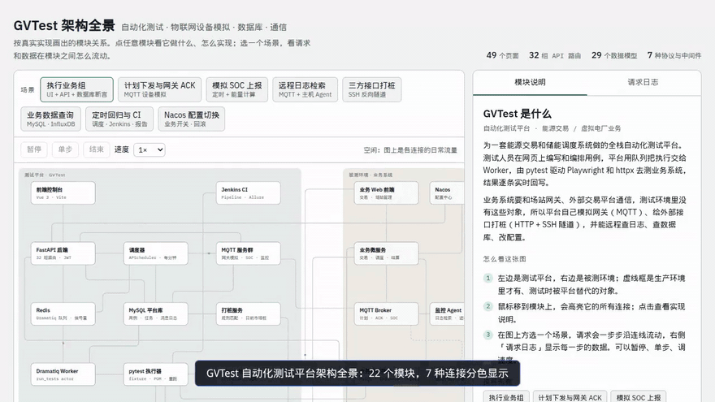

# ai-gvtest · GVTest 架构全景

GVTest 是一个全栈自动化测试平台，被测对象是一套能源交易 / 储能调度业务系统。这个仓库是它的**交互式架构演示页**：按真实实现画出模块、中间件和它们之间的数据流，可以逐步回放请求，并查看每一步的数据。

> 演示页只包含架构和模拟数据，不含平台源码和任何真实业务数据。

在线演示：<https://gvtest.edgebot.vip/>



**亮点**

- **平台规模**：49 个页面、32 个 API 路由、29 个数据模型，7 种协议与中间件
- **22 个模块的真实数据流**：HTTP、SQL、Redis、MQTT、SSH、进程内调用、CI 分色显示
- **8 个可回放场景**：逐步查看 JSON、MQTT 报文、SQL 和 pytest 输出，支持暂停、单步、0.5–3× 调速
- **零依赖部署**：单个静态 HTML，nginx 提供，带 `/healthz` 健康检查

## 能看到什么

- **架构图**：22 个模块，左边是测试平台，右边是被测环境；HTTP、SQL、Redis、MQTT、SSH、进程内调用、CI 七种连接分色显示，空闲时连线上有日常流量。
- **模块说明**：鼠标移上去高亮依赖；点击查看职责、技术栈、实现要点、连接和参与的场景。
- **8 个可回放场景**：数据包沿连线流动，右侧「请求日志」显示 JSON、MQTT 报文、SQL、pytest 输出；支持暂停、单步、0.5–3× 调速。

| 场景 | 体现的能力 |
|---|---|
| 执行业务组（UI + API + 数据库断言） | 队列调度、Playwright、失败截图与重跑、结果实时回写 |
| 计划下发与网关 ACK | MQTT 设备模拟 |
| 模拟 SOC 上报 | 定时任务、能量计算、时序数据 |
| 远程日志检索 | MQTT + 主机 Agent、retained 配置推送 |
| 三方接口打桩 | SSH 反向隧道、规则匹配 Mock |
| 业务数据查询 | MySQL / InfluxDB、连接池 |
| 定时回归与 CI | APScheduler、Jenkins、Allure |
| Nacos 配置切换 | 配置中心 Open API、差异与回滚 |

## 平台技术栈

FastAPI · Vue 3 · Dramatiq + Redis · MySQL · pytest · Playwright · httpx · Allure · paho-mqtt · paramiko · APScheduler · Nacos · InfluxDB · Jenkins · Docker Compose

## 运行

```bash
docker compose up -d          # 默认端口 8099，可用 PORT=xxxx 覆盖
# 打开 http://localhost:8099/
```

页面是单个静态 HTML，由 nginx 提供，`/healthz` 为健康检查。

## 修改页面

源文件是 `index.html`（没有 `<html>`/`<head>` 外壳）。改完后重新生成部署用的完整页面：

```bash
python deploy/make_site.py    # 输出 site/index.html，nginx 直接生效，不用重启
```

## 目录

```
index.html            页面源文件
site/index.html       生成的完整页面（nginx 根目录）
deploy/make_site.py   生成脚本
deploy/nginx.conf     nginx 配置
docker-compose.yml
```
